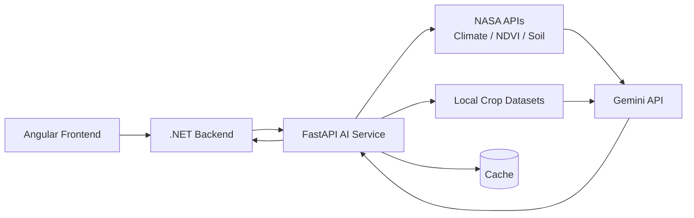

# 🌾 Crop Rotation AI Service

A FastAPI microservice that generates evidence-based crop rotation plans for farmers, using NASA satellite data and the Gemini API. It is part of a larger platform built with .NET and Angular.

---

## 🎯 The Problem

Farmers often choose what to plant based on habit or guesswork, without a clear view of how climate, soil health, and vegetation conditions have changed over the years. A wrong choice costs money, depletes the soil, and hurts long-term sustainability.

Satellite and climate data exist, but they are scattered across different sources and are hard for a farmer to interpret directly.

## 💡 The Solution

Given a farm's coordinates, this service:

1. Fetches **5 years** of climate, vegetation (NDVI), and soil data from NASA.
2. Combines it with local crop datasets.
3. Sends the structured context to the **Gemini API**.
4. Returns **3 crop rotation plans**, each with a different goal:

| Plan | Goal |
|------|------|
| 💰 **Economic** | Maximize expected profit |
| 🌱 **Soil Health** | Restore and protect soil quality |
| ♻️ **Sustainability** | Reduce water use and environmental impact |

Results are served through cached JSON endpoints so repeated requests for the same location are fast and don't waste API calls.

---

## 🏗️ Architecture



---

## 🛠️ Tech Stack

- **Language:** Python
- **Framework:** FastAPI
- **LLM:** Google Gemini API
- **Data sources:** NASA climate, vegetation (NDVI), and soil data
- **Data handling:** Pandas / NumPy *(adjust to what you used)*
- **Caching:** *(in-memory / file-based / Redis, adjust to what you used)*
- **Integration:** .NET backend + Angular frontend (built by teammates)

---

## 👤 My Role

I built the **AI microservice**:
- The data pipeline that fetches and processes NASA data by coordinates
- Prompt design and Gemini integration
- The FastAPI endpoints and the caching layer
- Integration with the .NET backend

The .NET backend and Angular frontend were built by my teammates.

---

## 🚀 Getting Started

### 1. Clone the repo
```bash
git clone https://github.com/<your-username>/crop-rotation-ai-service.git
cd crop-rotation-ai-service
```

### 2. Create a virtual environment and install dependencies
```bash
python -m venv venv
source venv/bin/activate        # Windows: venv\Scripts\activate
pip install -r requirements.txt
```

### 3. Configure environment variables
Copy `.env.example` to `.env` and add your own key:
```env
GEMINI_API_KEY=your_key_here
```
> ⚠️ Never commit your `.env` file.

### 4. Run the service
```bash
uvicorn main:app --reload
```
Interactive API docs will be available at `http://127.0.0.1:8000/docs`.

---

## 📡 API Example

> Replace with your real endpoint and response.

**Request**
```http
GET /recommend?lat=30.95&lon=30.82
```

**Response**
```json
{
  "location": { "lat": 30.95, "lon": 30.82 },
  "plans": {
    "economic": { "rotation": ["..."], "reasoning": "..." },
    "soil_health": { "rotation": ["..."], "reasoning": "..." },
    "sustainability": { "rotation": ["..."], "reasoning": "..." }
  }
}
```

---

## 🔮 Roadmap (Next Steps)

I'm continuing to improve this project. Planned work:

- [ ] **Validate LLM output** with Pydantic schemas so every response follows a strict structure
- [ ] **Add automated tests** (pytest) for the data pipeline and endpoints
- [ ] **Containerize** the service with Docker
- [ ] **Evaluate plan quality** by comparing the generated recommendations against real agricultural references
- [ ] **Improve prompts** and measure the effect on output consistency
- [ ] **Set up CI** with GitHub Actions
- [ ] **Deploy** the service and publish a live demo
- [ ] **Add performance numbers** (response time with and without cache)
